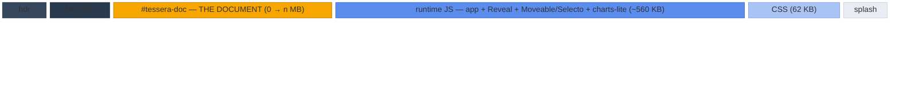
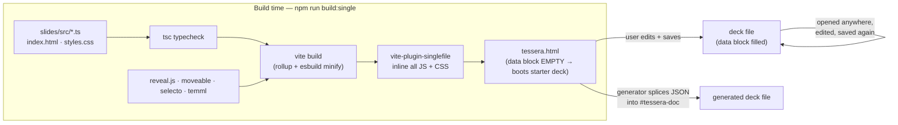
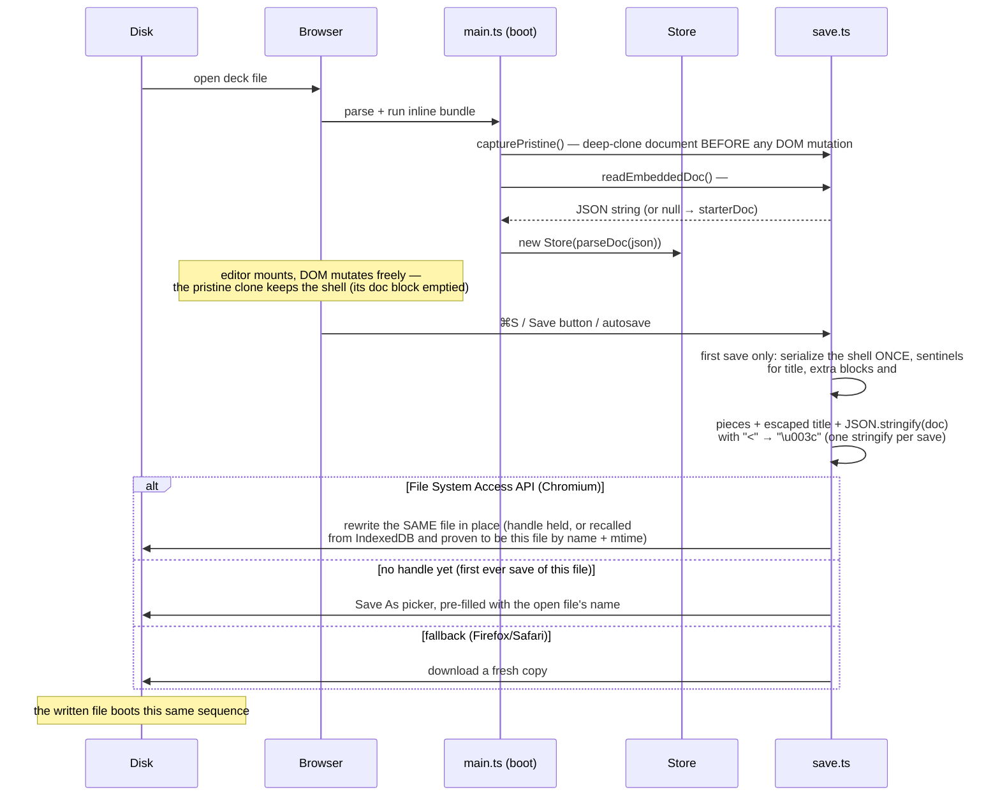
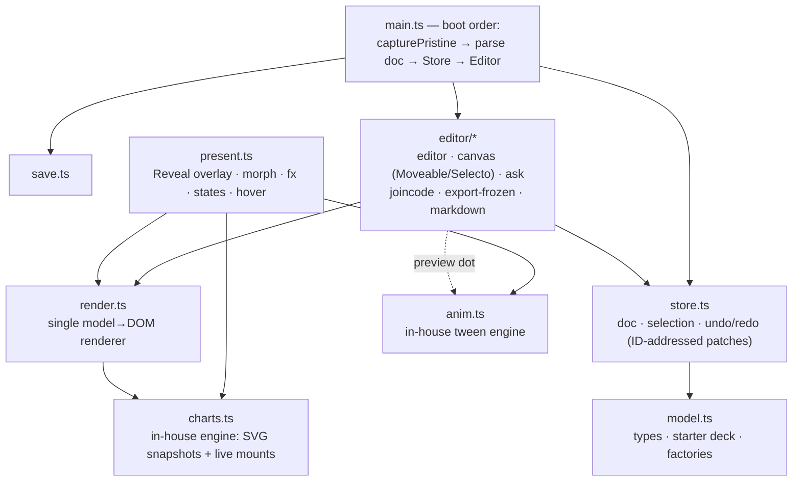

# tessera/slides — architecture

*Engineering reference (upstream's, July 2026; trimmed to the fork on
2026-10-22). Covers how a deck `.html` file is constructed, what the on-disk
format looks like, and how the runtime is organized.*

The core idea: **one HTML file is simultaneously the document, the viewer,
the presenter, and the editor.** There is no server, no install, and no
companion app — opening the file in a browser gives the full experience, and
the file saves *itself* back to disk with updated content (the TiddlyWiki
trick, modernized with the File System Access API).

---

> **v0.7.0 update**: the runtime now ships DEFLATE-compressed (shell ≈373KB,
> was 1.33MB) — byte order: chrome → NOTICE → tooling comment → **plaintext
> `#tessera-doc`** → splash → compressed payloads + 1KB loader last. The
> document block stays plaintext forever (AI/tooling + old-updater splice
> contract; `scripts/shell-gate.mjs` checks it). Charts are now in-house
> (`charts-lite`, MIT) — ECharts/zrender removed. Diagrams below describe the
> uncompressed layout; sizes predate compression.

> **2026-10-22**: the relay, self-update, PDF export and the About dialog are
> gone. What remains of upstream's collaboration is the in-house CRDT syncing
> tabs on one machine (§7).

## 1. On-disk anatomy

A deck `.html` file is ordinary, valid HTML. Its compartments, drawn
roughly to scale (widths √-compressed so the small parts stay visible —
exact numbers in the table below):



The amber block is the only part that changes between saves — everything
else is the fixed *shell*. Skeleton of the actual markup
(`dist-single/tessera.html`):

```html
<!DOCTYPE html>
<html lang="en">
<head>
  <meta charset="UTF-8"> <meta name="viewport" …> <meta name="generator" content="tessera">
  <link rel="icon" href="data:image/svg+xml,…">
  <title>Deck title — Tessera</title>

  <!-- NOTICE — bundled open-source components …
       (license notices; part of the shell, so they travel with every copy) -->

  <!-- ═══ THE DOCUMENT ═══ (empty in a fresh shell → boots the starter deck) -->
  <script type="application/tessera+json" id="tessera-doc">
    {"format":"tessera/slides","title":"…","size":{…},"slides":[…]}
  </script>

  <!-- ═══ THE RUNTIME ═══ viewer + presenter + editor, one inlined bundle -->
  <script type="module">/* ≈560 KB minified JS */</script>
  <style>/* ≈62 KB minified CSS — editor chrome, present overlay */</style>
  <style>/* splash CSS — paints before the bundle parses */</style>
</head>
<body>
  <div id="tessera-splash">…</div>   <!-- pure-CSS boot splash -->
  <div id="app"></div>             <!-- the runtime mounts the editor here -->
</body>
</html>
```

Layout and sizes, in file order — illustrative figures for the *uncompressed*
runtime (the shipped shell is DEFLATE-compressed, see the v0.7.0 note above; the
*order* is what's fixed, byte offsets shift with the data block's size):

| # | Part | ≈ size (raw) | What it is |
|---|---|---|---|
| 1 | Head chrome | 0.7 KB | doctype, metas, favicon, title |
| 2 | NOTICE comment | 2 KB | bundled-library license notices |
| 3 | **`#tessera-doc` data block** | **0 → *n* MB** | **the document** — JSON, `<` escaped; assets are data URIs, so image-heavy decks dominate the file |
| 4 | Runtime JS | ~560 KB | app (~120 KB) + Reveal.js + Moveable/Selecto family + charts-lite (in-house SVG charts, replaced ECharts in v0.7.0) |
| 5 | Runtime CSS | 62 KB | editor + present styles |
| 6 | Splash CSS + body mounts | 2 KB | splash `<style>`/`<div>`, `#app` mount |

Once DEFLATE-compressed for shipping, the whole shell is well under 600 KB on
disk before any document content (≈558 KB in the current build; it grows slowly
as features land — the v0.7.0 note records the compression milestone).

Two hard rules keep the file well-formed:

1. **The data block JSON escapes every `<` as `\u003c`**, so the string
   `</script>` can physically never appear inside it and terminate the block.
2. **The runtime source never contains a literal script-close tag** — the one
   place that needs it (`save.ts`) builds it by string concatenation, because
   that code ships *inside* a `<script>` element of the very file it writes.

## 2. How a file is constructed

Two producers make deck files: the Vite build (makes the empty *shell*) and
the runtime's own save path (makes every subsequent copy). Generators (like
the testing deck transpiler) are a third, minor path: they take the shell and
splice a JSON document into its data block.



The saved file is again a complete construction kit — there is no difference
in kind between the shell and a user's document, only the data block content.

## 3. The self-save loop



Consequences of the pristine-clone design:

- Anything present in the shipped HTML (NOTICE comment, splash, favicon)
  survives every save unchanged — documents self-carry their license notices.
- The runtime version is **pinned inside each document**: opening an old file
  runs its old editor. Upgrading a document means re-splicing its data block
  into a newer shell (`scripts/upgrade-deck.mjs`).
- Editor state (selection, zoom) never leaks into the file;
  only the model JSON changes between saves. UI prefs live in `localStorage`.

**The split shell (2026-10-22).** Re-cloning the pristine Document and running
`outerHTML` on every save cost ~370 ms per autosave on a 14 MB deck (the clone
still held the boot-time document text). Now `capturePristine` empties the
copy's data block, the first save serializes the shell once with random
sentinels where the title, the app's extra blocks (`registerShellBlocks`) and
the document go (`buildTemplate`, `kernel/src/save.ts`), and every save is
`serializeBodyParts`: the template's pieces around the escaped JSON. The
output is byte-identical to the old path (`serializeFileSlow`, kept as the
reference; checked on a 3.5 MB and a 14 MB deck, including a title with
`& < >` and a no-break space). The pieces go straight into a `Blob`, so the
15 MB file string is never joined for a handle write or a bridge save.

The autosave (`editor.ts autosaveOnce`) makes ONE `JSON.stringify` of the
document per save and shares it with the recovery snapshot, the version
checkpoint, the file and the bridge's fold base. "Did anything change during
the save" is a revision counter bumped on every store `doc` event, not two
full-document JSON keys. Measured on the 14 MB deck: ~7 full-document JSON
passes, the 371 ms serialize and a 186 ms JSON wrap of the HTML per save
became one ~70 ms task.

## 4. The document model (`format: "tessera/slides"`)

The data block holds one JSON object. Sketch of the current shape — see
`src/model.ts` for the authoritative types:

```
TesseraDoc
├─ format: "tessera/slides"
├─ title
├─ size: { width: 1280, height: 720 }   ← canonical 16:9; per-doc
├─ theme: { fontFamily, … }
├─ present?: { slideNumber?, controls?, progress? }
├─ assets?: { key → data URI }        ← images, fonts; referenced as "asset:key"
├─ fonts?: [{ family, asset, weight?, style? }]  ← @font-face injected at boot
├─ layouts?: Slide[]                  ← templates; instantiation KEEPS element ids (lineage → morph continuity)
└─ slides: Slide[]                 ← linear order; states sit right after their parent
   ├─ id                           ← stable; morph matches elements ACROSS slides by element id
   ├─ background · transition      ← none | fade | slide | zoom | morph
   ├─ name? · notes
   ├─ stateOf?                     ← marks a hidden interactive state of another slide
   ├─ hover?                       ← { type:'focus-group', dim } | { type:'reveal', default }
   ├─ comments?                       ← review threads, anchored to element/point/slide (editor-only; window.tessera.comments() for tooling)
   └─ elements: SlideElement[]     ← array order = paint order (z)
      ├─ common: id · x y w h · rotation · opacity
      │          fx? · link? · group? · groupId? · showOnHover? · role?
      ├─ text:  html (sanitized inline: b/i/u/s/code/br/span…) · placeholder? · fontSize · fontFamily
      │         fontWeight · color · align · valign · lineHeight · letterSpacing?
      ├─ shape: shape (rect|ellipse|triangle|arrow|line|path) · fill · fillGradient?
      │         stroke · strokeWidth · strokeStyle? (solid|dashed|dotted) · radius
      │         lineStart?/lineEnd? (none|arrow|dot|bar) · d?/pathBox? (path kind)
      ├─ image: src ("asset:key" or data URI) · fit · radius
      ├─ svg:   asset?/markup? · css? (scoped per element at render)
      ├─ chart: preset? · option · source? ← ECharts-SHAPED pure-JSON option
      │         (template-string formatters only — functions can't serialize);
      │         drawn by the in-house charts-lite engine; source={tableId}
      │         binds it live to a table element
      ├─ table: columns[{w}] · rows[{cells[{html,align?,color?,bg?,bold?}]}]
      │         · header · style{headerBg,zebra?,borderColor,cellPad…,radius…}
      │         ← a real HTML <table>, rendered by the shared renderer
      └─ media: kind (video|audio) · src (data URI | URL | "asset:key")
                · poster? fit? radius? · controls/autoplay/loop/muted
                ← autoplay fires in present mode only
```

Text also resolves dynamic-field tokens at render time — `{{page}}`,
`{{pages}}`, `{{title}}`, `{{date}}`, `{{time}}` (page/pages take a zero-pad
width, `{{page:2}}`) — so page numbering re-flows when slides move. The MODEL
stores the raw token; only the rendered output is resolved.

`fx` carries all presentation behavior:

| Field | Meaning |
|---|---|
| `enter: 'fade' \| 'fade-up' \| 'fade-down' \| 'slide-left/right/up/down'`, `order` | staggered entrance; equal `order` values enter together |
| `countUp` | numbers in the text animate 0 → final |
| `ambient: 'kenburns'`, `ken: {dir, scale, duration}` | photo drift loop, or one-shot zoom-in/out settle |
| `loop: {type:'dash-march', …}` | marching dashed strokes |
| `loop: {type:'motion-path', path, duration, delay}` | element travels an SVG path **relative to its rest position** (first point = 0,0) |

Interactivity is composed from three primitives, all plain data: element
`link` (click → jump to slide id), slide `stateOf` (hidden variants reached by
links, morphing on shared element ids), and `showOnHover` sets with slide
`hover` (in-slide hover reveals). Charts on either side of a morph with the
same element id additionally animate their *data* — the in-house chart engine
tweens the option's numeric leaves (a bar⇄pie type change stages a fade+sweep).

## 5. Runtime organization



One renderer, three surfaces — the same `render.ts` output is consumed
everywhere, which is what keeps WYSIWYG honest:

| Surface | Host | Charts | Notes |
|---|---|---|---|
| Editor canvas | `.ed-stage-scale` (CSS-scaled) | static SVG snapshot | Moveable control box mounts *inside* the scale wrapper (see OVERVIEW.md gotcha 1) |
| Sidebar thumbnails | per-slide mini surface | snapshot | `svg` elements collapse to `` for cheapness |
| Present | Reveal.js sections | **live instance** (tooltips, dataZoom) | fx/morph/states run here only |

Animation is fully in-house (`anim.ts`, no GSAP): tween channels for
opacity/transform/colors/SVG attributes/motion paths, a per-element transform
registry that preserves model rotation, and kill/query APIs that the exit
restore and the 2.8 s wall-clock settle guarantee are built on. Morph
geometry is **model-driven** — both slides' frames are in the doc, so nothing
measures the DOM.

## 6. Format invariants

Things generators and future format revisions must not break:

1. `format: "tessera/slides"` plus additive, optional fields — old files must
   open in newer shells (unknown fields are preserved by parse → serialize).
2. Element **ids are identity**: morphs match on them across slides, states
   sync from parents by id lineage, links point at slide ids. Generators must
   emit deterministic ids.
3. Data block JSON must stay `<`-escaped; chart options and text HTML must be
   pure data (the sanitizer whitelist and the no-functions rule exist so a
   document can never smuggle executable code through the model).
4. Asset references are `asset:` keys into `doc.assets`; nothing outside the
   file may be fetched at view time (single-file promise, and the CSP story
   for future hosting).
5. Motion paths are stored relative to the element's rest position; the first
   path point is that position by definition.
6. Every document carries a stable `docId` (uuid, minted at creation, minted
   on load for pre-docId files). It is identity for future sync/share/merge —
   never derive it from content, never regenerate it on save.

## 7. Tab-to-tab sync

The in-house CRDT designed in `collab-design.md`. Two tabs or files with one
`docId`, open in the same browser profile, converge over BroadcastChannel;
nothing leaves the machine. (The end-to-end-encrypted relay it was built for,
`sync/online.ts` and `server/sync-worker`, was removed on 2026-10-22.)

```
slides/src/sync/crdt.ts     engine: per-property LWW registers ordered by
                            (lamport, actor); birth/tomb liveness (an ins is
                            a whole-node assignment that resurrects by
                            out-stamping the tomb); fractional-index order
                            keys; dead-window value stash; token RGA for
                            element.html (deterministic content-hash seeds;
                            a generation duels plain sets AS A UNIT);
                            per-actor contiguous seq + gap buffering;
                            state-based mergeSnapshot for file forks
slides/src/sync/session.ts  the store bridge: local commits → debounced
                            shadow diff → ops out; remote ops → surgical
                            apply → the same store events the editor
                            already listens to, scoped (store.scope) to the
                            slides the ops touched. Catch-up between tabs.
scripts/test-sync.ts        property-based convergence rig (SEEDS/STEPS/
                            ACTORS env knobs) — random op interleavings
                            across simulated actors must converge to
                            byte-identical docs AND sync state
```

`identity-watch.ts` raises a banner when a second FILE with the same `docId`
is open, since its edits will merge in; its "Make this file independent"
button, Save ▾ → "Save a copy…" (always a new id) or `slide.py fork` give a copy its
own id. Files saved by older shells may carry `doc.collab`; it is kept and
never used.
